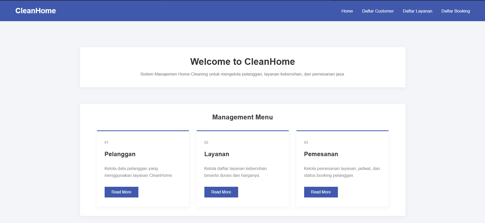

# Tugas Praktikum 7 DPBO

## Janji

Saya Ingrid Gabryella Nainggolan dengan NIM 2506442 mengerjakan TP 7 dalam mata kuliah Desain dan Pemrograman Berorientasi Objek untuk keberkahan-Nya maka saya tidak melakukan kecurangan seperti yang telah dispesifikasikan. Aamiin.

## 1. Deskripsi Project

**CleanHome** merupakan aplikasi berbasis web yang dirancang untuk membantu pengelolaan layanan jasa kebersihan rumah (*home cleaning service*). Aplikasi ini dibuat menggunakan PHP Native dengan konsep Object-Oriented Programming (OOP) serta database MySQL.

Aplikasi CleanHome menyediakan pengelolaan data customer, layanan kebersihan, dan booking layanan. Pengguna dapat menambahkan, melihat, mengubah, dan menghapus data melalui halaman yang telah disediakan.

Project ini dibuat untuk menerapkan konsep OOP, pengelolaan database, serta operasi CRUD (*Create, Read, Update, Delete*) menggunakan PDO Prepared Statements.


## 2. Fitur Aplikasi

Aplikasi CleanHome memiliki beberapa fitur utama sebagai berikut.

### 2.1 Dashboard

Dashboard merupakan halaman utama aplikasi yang menyediakan navigasi menuju halaman pengelolaan data customer, layanan, dan booking.

### 2.2 Pengelolaan Customer

Fitur ini digunakan untuk mengelola informasi customer yang menggunakan jasa CleanHome.

Operasi yang tersedia:
- **Create:** Menambahkan data customer baru.
- **Read:** Menampilkan seluruh data customer.
- **Update:** Mengubah informasi customer.
- **Delete:** Menghapus data customer apabila tidak memiliki booking yang masih terhubung.

Data customer yang disimpan meliputi:
- ID Customer
- Nama Customer
- Email
- Nomor Telepon

### 2.3 Pengelolaan Service

Fitur ini digunakan untuk mengelola berbagai layanan kebersihan yang tersedia.

Operasi yang tersedia:
- **Create:** Menambahkan layanan baru.
- **Read:** Menampilkan seluruh layanan.
- **Update:** Mengubah informasi layanan.
- **Delete:** Menghapus layanan apabila tidak sedang digunakan dalam booking.

Data service yang disimpan meliputi:
- ID Service
- Nama Service
- Deskripsi
- Durasi Pengerjaan
- Harga

### 2.4 Pengelolaan Booking

Fitur ini digunakan untuk mengelola pemesanan layanan kebersihan oleh customer.

Operasi yang tersedia:
- **Create:** Membuat booking baru dengan memilih customer dan layanan.
- **Read:** Menampilkan seluruh data booking.
- **Update:** Mengubah informasi booking.
- **Delete:** Menghapus data booking.

Data booking yang disimpan meliputi:
- ID Booking
- Customer
- Service
- Tanggal Booking
- Jam Booking
- Jenis Properti
- Alamat Layanan
- Catatan
- Status Booking
- Total Harga

Status booking yang tersedia:
- Pending
- Confirmed
- In Progress
- Completed
- Cancelled

Total harga disimpan pada tabel booking sebagai nilai harga layanan ketika pemesanan dibuat.

## 3. Perancangan Database

Aplikasi CleanHome menggunakan database bernama `db_homeservice` yang terdiri dari tiga tabel utama, yaitu `customers`, `services`, dan `bookings`.

### 3.1 Tabel Customers

Tabel `customers` digunakan untuk menyimpan informasi customer yang menggunakan layanan CleanHome.

| Nama Kolom | Tipe Data | Keterangan |
|---|---|---|
| id_customer | INT | Primary Key, Auto Increment |
| nama_customer | VARCHAR(255) | Nama customer |
| email | VARCHAR(100) | Email customer, bersifat UNIQUE |
| no_telepon | VARCHAR(20) | Nomor telepon customer |

### 3.2 Tabel Services

Tabel `services` digunakan untuk menyimpan informasi layanan kebersihan yang tersedia.

| Nama Kolom | Tipe Data | Keterangan |
|---|---|---|
| id_service | INT | Primary Key, Auto Increment |
| nama_service | VARCHAR(100) | Nama layanan |
| deskripsi | TEXT | Deskripsi layanan |
| durasi | INT | Durasi pengerjaan dalam menit |
| harga | DECIMAL(10,2) | Harga layanan |

### 3.3 Tabel Bookings

Tabel `bookings` digunakan untuk menyimpan informasi pemesanan layanan oleh customer.

| Nama Kolom | Tipe Data | Keterangan |
|---|---|---|
| id_booking | INT | Primary Key, Auto Increment |
| id_customer | INT | Foreign Key dari tabel customers |
| id_service | INT | Foreign Key dari tabel services |
| tanggal_booking | DATE | Tanggal pemesanan |
| jam_booking | TIME | Jam pemesanan |
| jenis_properti | ENUM | Jenis properti (Rumah, Apartemen, Kos) |
| alamat_layanan | TEXT | Alamat lokasi layanan |
| catatan | TEXT | Catatan tambahan |
| status_booking | ENUM | Status pemesanan |
| total_harga | DECIMAL(10,2) | Total harga booking |

###34.4 Relasi Antar Tabel

Database CleanHome memiliki hubungan antar tabel sebagai berikut:

- **Customers dengan Bookings (One-to-Many):** Satu customer dapat memiliki lebih dari satu booking, sedangkan satu booking hanya dimiliki oleh satu customer.
- **Services dengan Bookings (One-to-Many):** Satu layanan dapat digunakan dalam beberapa booking, sedangkan satu booking hanya menggunakan satu layanan.

Relasi tersebut diterapkan menggunakan Foreign Key pada tabel `bookings`.

```sql
FOREIGN KEY (id_customer) REFERENCES customers(id_customer),
FOREIGN KEY (id_service) REFERENCES services(id_service)
```

Dengan adanya relasi tersebut, data booking akan selalu terhubung dengan customer dan layanan yang sesuai.

### 3.5 Aturan Penghapusan Data

Penghapusan data pada aplikasi CleanHome memiliki aturan tertentu karena tabel `customers`, `services`, dan `bookings` saling berhubungan menggunakan Foreign Key.

**1. Penghapusan Customer**

Data customer tidak dapat dihapus apabila masih memiliki data booking yang terhubung dengannya.

- **Customer dapat dihapus:** Apabila customer belum pernah membuat booking atau seluruh booking miliknya sudah dihapus.
- **Customer tidak dapat dihapus:** Apabila masih terdapat booking yang menggunakan ID customer tersebut.

Hal ini terjadi karena kolom `id_customer` pada tabel `bookings` merupakan Foreign Key yang mengacu pada tabel `customers`.

**2. Penghapusan Service**

Data service tidak dapat dihapus apabila masih digunakan dalam data booking.

- **Service dapat dihapus:** Apabila layanan belum pernah digunakan dalam booking atau seluruh booking yang menggunakan layanan tersebut sudah dihapus.
- **Service tidak dapat dihapus:** Apabila masih terdapat booking yang menggunakan ID service tersebut.

Hal ini terjadi karena kolom `id_service` pada tabel `bookings` merupakan Foreign Key yang mengacu pada tabel `services`.

**3. Penghapusan Booking**

Data booking dapat dihapus secara langsung selama data tersebut tersedia di database.

- Penghapusan booking tidak akan menghapus data customer yang terhubung.
- Penghapusan booking tidak akan menghapus data service yang digunakan.
- Setelah booking dihapus, customer atau service yang sebelumnya terhubung dapat dihapus apabila sudah tidak memiliki hubungan dengan booking lainnya.

**Catatan:** Database CleanHome tidak menggunakan `ON DELETE CASCADE`. Oleh karena itu, penghapusan customer atau service tidak otomatis menghapus data booking yang berhubungan dengannya. Penghapusan harus dilakukan secara berurutan, yaitu menghapus booking terlebih dahulu sebelum menghapus customer atau service terkait.

## 4. Struktur Folder Project

Struktur folder aplikasi CleanHome adalah sebagai berikut:

```text
CleanHome/
│
├── class/                  # Menyimpan class untuk setiap entitas
│   ├── Customer.php        # Class untuk mengelola data customer
│   ├── Service.php         # Class untuk mengelola data layanan
│   └── Booking.php         # Class untuk mengelola data booking
│
├── config/                 # Menyimpan konfigurasi aplikasi
│   └── db.php              # Mengatur koneksi database menggunakan PDO
│
├── database/               # Menyimpan file database
│   └── db_homeservice.php  # File database db_homeservice
│
├── view/                   # Menyimpan halaman tampilan dan CRUD
│   ├── header.php          # Bagian header dan navigasi website
│   ├── footer.php          # Bagian footer website
│   ├── customer.php        # Halaman CRUD customer
│   ├── service.php         # Halaman CRUD service
│   └── booking.php         # Halaman CRUD booking
│
├── index.php               # Halaman utama atau dashboard aplikasi
└── style.css               # Mengatur tampilan dan desain website
```

## 5. Penerapan Konsep OOP

Aplikasi CleanHome menerapkan konsep Object-Oriented Programming (OOP) dengan membagi pengelolaan data ke dalam beberapa class berdasarkan entitasnya.

### 5.1 Class Customer

Class `Customer` bertanggung jawab untuk mengelola seluruh operasi yang berkaitan dengan data customer.

Method yang digunakan:
- `getAllCustomer()` — Mengambil seluruh data customer.
- `getAllCustomerById()` — Mengambil data customer berdasarkan ID.
- `createCustomer()` — Menambahkan data customer.
- `updateCustomer()` — Mengubah data customer.
- `deleteCustomer()` — Menghapus data customer.

### 5.2 Class Service

Class `Service` bertanggung jawab untuk mengelola seluruh operasi yang berkaitan dengan data layanan.

Method yang digunakan:
- `getAllService()` — Mengambil seluruh data layanan.
- `getServiceById()` — Mengambil data layanan berdasarkan ID.
- `createService()` — Menambahkan layanan baru.
- `updateService()` — Mengubah data layanan.
- `deleteService()` — Menghapus data layanan.

### 5.3 Class Booking

Class `Booking` bertanggung jawab untuk mengelola seluruh operasi yang berkaitan dengan data pemesanan.

Method yang digunakan:
- `getAllBooking()` — Mengambil seluruh data booking.
- `getBookingById()` — Mengambil data booking berdasarkan ID.
- `createBooking()` — Menambahkan booking baru.
- `updateBooking()` — Mengubah data booking.
- `deleteBooking()` — Menghapus data booking.

### 5.4 Class Database

Class `Database` digunakan untuk mengatur koneksi antara aplikasi PHP dengan database MySQL menggunakan PDO.

Koneksi database dibuat melalui objek PDO dan menggunakan konfigurasi `PDO::ATTR_ERRMODE` dengan `PDO::ERRMODE_EXCEPTION` agar kesalahan dalam proses database dapat ditangani menggunakan exception.

Setiap class entitas menggunakan koneksi database tersebut untuk menjalankan operasi CRUD.

## 6. Alur Kerja Aplikasi

Aplikasi CleanHome menggunakan pemisahan antara bagian tampilan (View), pengelolaan data (Class), dan koneksi database.

### 6.1 Alur Request dan Response

Berikut merupakan alur kerja aplikasi ketika pengguna melakukan suatu tindakan:

1. Pengguna membuka halaman aplikasi melalui browser.
2. Browser mengirimkan HTTP Request menuju file PHP yang dituju.
3. File PHP pada folder `view/` menerima request dari pengguna.
4. Halaman View memanggil method pada class yang sesuai.
5. Class menjalankan perintah SQL menggunakan PDO Prepared Statements.
6. PDO menghubungkan aplikasi dengan database MySQL.
7. MySQL memproses perintah SQL dan mengembalikan hasilnya.
8. Hasil pemrosesan dikembalikan ke class, kemudian diteruskan ke halaman View.
9. PHP menghasilkan HTML sebagai HTTP Response.
10. Browser menampilkan hasil pemrosesan kepada pengguna.

### 6.2 Diagram Alur Request dan Response

```text
+------------------+
|      Browser     |
|      Pengguna    |
+------------------+
         |
         | HTTP Request
         v
+------------------+
|       View       |
| customer.php     |
| service.php      |
| booking.php      |
+------------------+
         |
         | Memanggil Method
         v
+------------------+
|      Class       |
| Customer         |
| Service          |
| Booking          |
+------------------+
         |
         | PDO Prepared Statements
         v
+------------------+
|    Database      |
|       PDO        |
+------------------+
         |
         | SQL Query
         v
+------------------+
|      MySQL       |
|   db_homeservice |
+------------------+
         |
         | Hasil Query
         v
+------------------+
|       View       |
|  Menampilkan Data|
+------------------+
         |
         | HTTP Response
         v
+------------------+
|      Browser     |
| Menampilkan HTML |
+------------------+
```

### 6.3 Alur Operasi CRUD

**Create (Menambahkan Data)**

1. Pengguna mengisi form pada halaman View.
2. Pengguna menekan tombol simpan.
3. Data dikirimkan menggunakan metode HTTP POST.
4. View memanggil method `create` pada class terkait.
5. Class menjalankan perintah SQL INSERT menggunakan Prepared Statements.
6. Database menyimpan data baru.
7. Pengguna diarahkan kembali ke halaman terkait dengan informasi status operasi.

**Read (Menampilkan Data)**

1. Pengguna membuka halaman terkait.
2. View memanggil method `getAll` pada class.
3. Class menjalankan perintah SQL SELECT.
4. Database mengembalikan data yang diminta.
5. View menampilkan data dalam bentuk tabel.

**Update (Mengubah Data)**

1. Pengguna menekan tombol Edit pada data yang ingin diubah.
2. View mengambil data berdasarkan ID menggunakan method terkait.
3. Data yang dipilih ditampilkan kembali pada form.
4. Pengguna mengubah informasi yang diperlukan.
5. Data dikirimkan menggunakan metode HTTP POST.
6. View memanggil method `update` pada class.
7. Class menjalankan perintah SQL UPDATE menggunakan Prepared Statements.
8. Database memperbarui data.
9. Pengguna diarahkan kembali ke halaman terkait.

**Delete (Menghapus Data)**

1. Pengguna menekan tombol Delete pada data yang ingin dihapus.
2. View menerima ID data melalui HTTP POST.
3. View memanggil method `delete` pada class.
4. Class menjalankan perintah SQL DELETE menggunakan Prepared Statements.
5. Database memproses penghapusan data.
6. Apabila data memiliki relasi Foreign Key yang masih digunakan, penghapusan customer atau service akan ditolak oleh database.
7. Pengguna diarahkan kembali ke halaman terkait dengan informasi hasil operasi.

## 7. Keamanan dan Pengelolaan Database

Dalam pengembangan aplikasi CleanHome, terdapat beberapa penerapan untuk menjaga keamanan dan konsistensi data.

### 7.1 PDO Prepared Statements

Seluruh operasi database menggunakan PDO Prepared Statements dengan kombinasi `prepare()` dan `execute()`.

Penggunaan Prepared Statements membantu mencegah SQL Injection karena nilai input pengguna dipisahkan dari struktur perintah SQL.

### 7.2 Foreign Key

Foreign Key digunakan untuk menjaga hubungan antara tabel customer, service, dan booking.

Dengan demikian, database dapat mencegah penghapusan data customer atau service yang masih digunakan oleh booking.

### 7.3 Error Handling

Operasi penghapusan customer dan service menggunakan penanganan `PDOException` untuk menangani kegagalan penghapusan akibat pelanggaran relasi Foreign Key.

Apabila penghapusan gagal, method akan mengembalikan nilai `false`.

### 7.4 Validasi Data

Aplikasi menggunakan atribut form HTML seperti `required` dan tipe input yang sesuai untuk membantu memastikan data yang dimasukkan pengguna memenuhi kebutuhan form.

## 8. Dokumentasi Aplikasi

Bagian ini berisi dokumentasi tampilan dan pengujian fitur CRUD pada aplikasi CleanHome.

### 8.1 Dashboard

Menampilkan halaman utama aplikasi yang berisi navigasi menuju fitur pengelolaan customer, service, dan booking.



### 8.2 CRUD Customer

### 8.3 CRUD Service

### 8.4 CRUD Service
